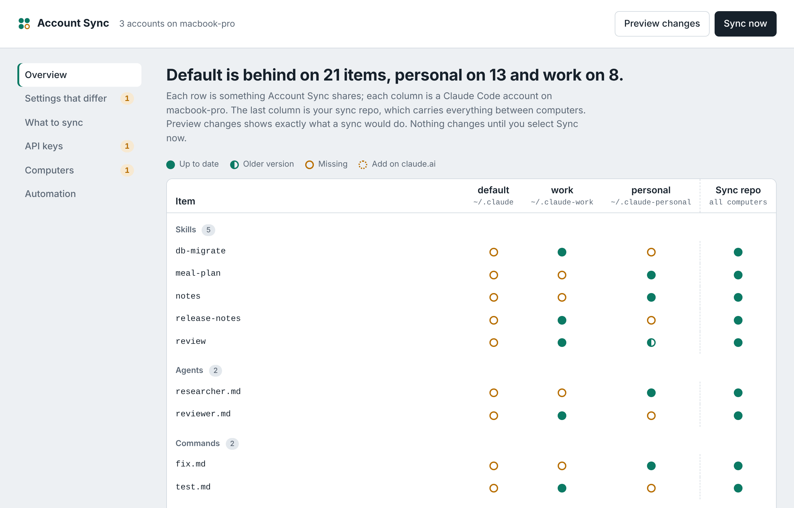

# Account Sync for Claude Code

**Every Claude Code account, on every computer, with the same setup.**

Add a skill on your laptop, and your work account on your desktop has it tomorrow morning. Install an MCP server once, and it appears everywhere. Sign in to a brand-new account, and it starts with everything the others already have.

MIT license · Python 3.8+ · macOS, Windows and Linux · Claude Code plugin

If you run Claude Code under more than one account (work and personal, several clients, several machines), each one drifts. One has the good skills. Another has the MCP servers, a third the permission rules you tuned. Account Sync merges all of it into one set and keeps every account on it.

- **Union, not overwrite.** Settings, skills, agents, commands, rules, output styles, `CLAUDE.md`, user-level MCP servers, plugins and marketplaces from *all* your accounts are combined. Nothing is thrown away. When two accounts disagree, the newest version wins and the other is kept as a conflict copy.
- **New accounts are ready in one command.** They get the full set: files, settings, MCP servers, and plugins installed through the official `claude` CLI.
- **Secrets stay on your machine.** Tokens and API keys are replaced with placeholders before anything is shared. Each account keeps its own sign-in.
- **One setup across macOS, Windows and Linux.** Commands that only make sense on one system, like hooks and status lines, stay on computers of that type. Everything else is shared.
- **Safe by default.** `status` previews every change, every file it touches is backed up first, and a daily job or startup hook keeps everything in step.
- **A settings page when you want one.** `account-sync ui` opens your accounts side by side in the browser: what each one is missing, settings that differ, API keys a computer still needs, and the daily schedule.
- **No dependencies.** One Python file using the standard library. Share between computers through any private git repo.



> An independent community tool, not made or endorsed by Anthropic. It uses the public `claude` CLI and the documented Claude Code config files.

## Install

### As a Claude Code plugin

Inside Claude Code:

```
/plugin install account-sync --marketplace shorconsulting/claude-code-account-sync
```

On an older Claude Code, add the marketplace first: `/plugin marketplace add shorconsulting/claude-code-account-sync`, then `/plugin install account-sync@account-sync`.

Then ask Claude something like *"sync my Claude Code accounts"*. It runs the preview first and asks before changing anything.

### As a standalone tool

Run `init` once on each computer, from the folder that holds `account_sync.py`:

| | Command |
|---|---|
| **macOS / Linux** | `python3 account_sync.py init` |
| **Windows** (PowerShell or cmd) | `py -3 account_sync.py init` |

`init` finds every Claude Code account, copies the script to `~/.account-sync/` (on Windows, `%USERPROFILE%\.account-sync\`), and adds an **`account-sync` command** to your PATH. Open a new terminal window afterwards, and every command below is the same on all three systems. `init` also prints the exact fallback command for your system, in case the new command isn't on PATH yet.

To download only the script: `curl -fsSLO https://raw.githubusercontent.com/shorconsulting/claude-code-account-sync/main/account_sync.py` (macOS/Linux; Windows 10+ also has `curl.exe`).

> **Keep your hub private.** This repo holds the *tool*. The *hub* (your settings, skills and MCP server list) belongs in a **separate private** repo that you pass to `init --remote`. Secrets are stripped from the hub, but your configuration is still personal.

## What it syncs

| Item | Where it lives | How it's synced |
|---|---|---|
| `settings.json` (permissions, env, model, theme, `enabledPlugins`, `extraKnownMarketplaces`, …) | `<config dir>/settings.json` | Union merge: lists combined, objects merged, and for single values the most recently edited account wins |
| Settings that run commands: `hooks`, `statusLine`, `subagentStatusLine`, `fileSuggestion`, `processWrapper`, `defaultShell` | `<config dir>/settings.json` | Same merge, but **per operating system**: Macs share with Macs, PCs with PCs, Linux with Linux. A Mac's status-line script never lands on a Windows PC |
| Skills, commands, agents, rules, output styles, workflows, themes, hooks/scripts folders, `CLAUDE.md`, `keybindings.json`, top-level helper scripts | `<config dir>/…` | Copied as whole units (a skill folder is never mixed from two accounts). If two accounts have different versions, the newest wins and the other is kept in `hub/conflicts/` |
| User-scope MCP servers | `~/.claude.json` (or `<config dir>/.claude.json`) | Added with `claude mcp add-json --scope user` |
| Plugin marketplaces and plugins | `~/.claude/plugins` | Added with `claude plugin marketplace add` / `claude plugin install --scope user`; enabled/disabled state carried over |

**Never touched:** credentials and sign-in (`.credentials.json`, OAuth state in `.claude.json`), history, transcripts, project state, caches, and `settings.local.json`. Settings tied to a specific account's sign-in (`apiKeyHelper`, `ANTHROPIC_API_KEY`, `CLAUDE_CODE_OAUTH_TOKEN`, `forceLoginOrgUUID`, and similar) stay with their own account. Both lists are editable in `~/.account-sync/config.json`.

**Reported, not written:** claude.ai connectors, and skills/plugins synced from a claude.ai account. These live in each claude.ai account on Anthropic's servers, so no local tool can add them. account-sync inventories each account and prints exactly which ones each account is missing; you add those once at <https://claude.ai/customize/connectors> while signed in to that account. (On Team/Enterprise plans an admin can add connectors once for the whole org instead.)

## How it works

```
 account A ─┐                      ┌─► account A
 account B ─┼─ harvest ─► HUB ─ apply ─► account B
 account C ─┘   (union)   (git)     └─► account C (brand new)
```

- **Accounts** are found automatically: `~/.claude`, any `~/.claude-*` folder, `CLAUDE_CONFIG_DIR`, and `CLAUDE_CONFIG_DIR=…` aliases in your shell profiles.
- **The hub** (`~/.account-sync/hub`) is a git repo. Point it at a private remote and every machine shares it.
- **Paths** like `~/.claude-work/hooks/fmt.sh` are stored as `{{CLAUDE_CONFIG_DIR}}/hooks/fmt.sh` and rewritten for each account and machine.
- **Secrets** (tokens, API keys, passwords in MCP headers/env/args and in settings `env`) are replaced in the hub with `${CSYNC_…}` placeholders. The real values stay in `~/.account-sync/secrets.json` (mode 600, never committed). On another machine, copy that file over once, or export the variables it names.
- **Backups** of every file it changes go to `~/.account-sync/backups/<timestamp>/`.

## Setup

### One computer with several accounts

```bash
account-sync status     # preview: what each account would get. Changes nothing
account-sync sync       # do it
```

### Several computers (any mix of macOS, Windows and Linux)

Create an empty **private** git repo, then on each computer:

```bash
python3 account_sync.py init --remote git@github.com:YOUR-USERNAME/my-claude-config.git    # Windows: py -3 account_sync.py init --remote ...
account-sync sync
```

Run `sync` once on every computer, so each one adds its accounts to the union. Then run it once more on each, so each picks up what the others added. After that, automation keeps them in step. To have MCP secrets filled in automatically, copy `secrets.json` (in the `.account-sync` folder) between computers.

### Make it automatic (once on each computer)

```bash
account-sync schedule                  # daily at 09:00 local time
account-sync schedule --daily 07:30    # or pick the time
account-sync install-hook              # optional: also sync when Claude Code starts
```

| | macOS | Windows | Linux / WSL |
|---|---|---|---|
| Daily job | launchd (a run missed while asleep happens on wake) | Task Scheduler task "AccountSync", runs without a console window | cron |
| `account-sync` command | `~/.local/bin/account-sync` | `%USERPROFILE%\.local\bin\account-sync.cmd` | `~/.local/bin/account-sync` |
| Log | `~/.account-sync/sync.log` | `%USERPROFILE%\.account-sync\sync.log` | `~/.account-sync/sync.log` |

Add `--print` to `schedule` to see exactly what it would install, `--every N` to run every N minutes instead of daily, and `--remove` to undo.

Each daily run pulls what the other computers pushed, merges in this computer's accounts, updates all of them, and pushes the result back. A change made on one computer reaches another after both have run once, so up to about a day with a daily schedule. The startup hook shortens that: it runs a background sync when Claude Code starts, at most once every 30 minutes (set `min_interval_minutes` in `config.json` to change it). The hook is machine-local and never copied to other computers.

### Requirements on each computer

| | macOS | Windows | Linux |
|---|---|---|---|
| **Python 3.8+** (one install serves every account) | `xcode-select --install` or `brew install python` | `winget install Python.Python.3.13` (use `py -3`) | usually preinstalled; else `sudo apt install python3` |
| **git** (only for sharing between computers) | `xcode-select --install` | `winget install --id Git.Git -e` | `sudo apt install git` |
| **Claude Code** (`claude` on PATH) | already installed | already installed | already installed |

## Settings page

```bash
account-sync ui
```

Opens a page in your browser with every account on this computer side by side. From there you can:

- see what each account has and is missing, and preview or run a sync
- pick which value wins when accounts have different settings
- choose what gets synced and which settings stay with each account
- paste API keys this computer is missing (saved values are never shown again)
- see when each computer last synced, and turn the daily sync on or off

The page runs only on your own computer (127.0.0.1) while that terminal window is open, and it stops by itself 30 minutes after you close the tab. Its link carries a one-time code, so other user accounts on the same computer can't use it.

## Everyday commands

| Command | Does |
|---|---|
| `status` | Dry run of a full sync. Shows what each account is missing, including claude.ai connectors |
| `sync` | Harvest + apply + git pull/push |
| `sync --prefer work` | Same, but the `work` account wins every conflict |
| `harvest` / `apply` | Run either half on its own |
| `apply --force` | Overwrite differing MCP servers and newer local files |
| `apply --prune` | Make accounts mirror the hub exactly. Use this to **delete** something everywhere: remove it from `hub/files` (or the hub settings), then `apply --prune`. Removed items are backed up |
| `accounts add PATH --name NAME` | Register a config dir it didn't find |
| `discover` | List the config dirs it can see |
| `ui` | Open the settings page in your browser |

Because sync is a union, deleting a skill in one account doesn't delete it elsewhere; the next sync brings it back. Use `apply --prune` for deletions.

## Notes

- Plugins whose marketplace entry runs an install command ask for confirmation, which can't happen unattended. account-sync reports these; install them once by hand with `claude plugin install <name> -y`.
- `sync` uses the `claude` CLI found on `PATH`. For cron, `schedule` records its full path in `config.json`.
- Project-level config (a repo's `.claude/settings.json`, `.mcp.json`) is not synced; it already travels with the repo.
- The hub stores files byte for byte (`.gitattributes` turns off line-ending conversion), so Git for Windows can't make the same skill look different on a PC and a Mac.
- Scripts copied from a PC to a Mac or Linux account are made executable again automatically.
- **Windows status:** tested on a real PC (Windows 11, Python 3.13) on 2026-10-12: all 37 checks in `tests/windows_check.py` passed, including the Task Scheduler task, the `.cmd` command, hook paths, `.cmd`-safe MCP writes, byte-for-byte copies through git, and the settings page.
- **claude.ai connectors can't be added for you.** They live in each claude.ai account, so Account Sync lists what each account is missing and you add them at claude.ai/customize/connectors.

## Privacy and data

Account Sync has no telemetry and no server of its own. It reads and writes only:

- **Your Claude Code config folders** on this computer (the items in [What it syncs](#what-it-syncs)), with a backup of every file it changes.
- **Its hub**, `~/.account-sync/hub`, a local git repo. It is pushed only to the private remote you give `init --remote`, if any. Secrets are replaced with placeholders before anything is written to the hub; the real values stay in `~/.account-sync/secrets.json` (mode 600, never committed).
- **The official `claude` CLI**, to add MCP servers, marketplaces and plugins. Installing a plugin downloads it from the source its marketplace names, as `claude plugin install` always does.

The settings page listens on 127.0.0.1 only, behind a random per-run token. The source is one readable Python file, `account_sync.py`.

### Credentials it handles, and why

Your accounts' settings and MCP servers can contain tokens and API keys, for example an MCP server's `Authorization` header or a `GITHUB_TOKEN` in settings `env`. Account Sync reads them only to keep them out of the shared hub. Each value is swapped for a `${CSYNC_…}` placeholder before anything is written to the hub, and the real value goes to `~/.account-sync/secrets.json` (mode 600, never committed). When an account needs it, the value is written back into that account's own config on this computer, and an API key you enter on the settings page is stored the same way. Sign-in files (`.credentials.json`, OAuth state in `.claude.json`) are never touched. Account-specific values such as `ANTHROPIC_API_KEY` and `CLAUDE_CODE_OAUTH_TOKEN` stay in their own account and are never copied to the hub or to another account. No credential is sent anywhere. These can't be Claude Code `userConfig` values, because they belong to the MCP servers and settings you already have, not to this plugin.

## Tests

```bash
bash tests/run_tests.sh
```

Builds three fake accounts (one brand new) and a stub `claude` CLI in a temporary folder, runs a full sync, and checks the result (42 checks). The checks include a simulated second computer running Windows that shares the same hub, and the settings page's lock and input checks. Nothing outside that folder is touched.

On Windows (or any computer without bash), run the same kind of check in Python:

```powershell
py -3 tests\windows_check.py
```

It uses a throwaway home folder with spaces in its path and a stand-in `claude.cmd`, and drives this computer's real `cmd.exe`, Task Scheduler format and settings page. Add `--real-scheduler` to also create a real scheduled task for a moment and delete it again. Nothing outside that folder is touched.

## License

MIT. See [LICENSE](LICENSE).
